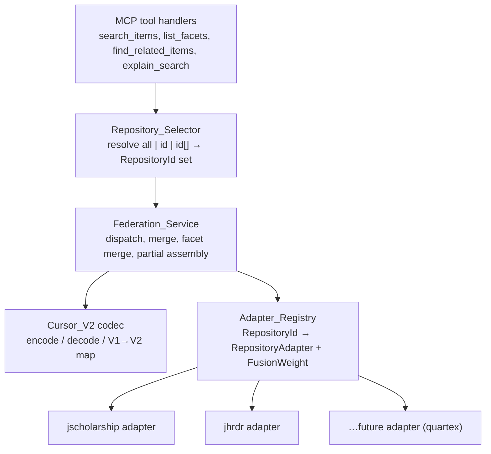
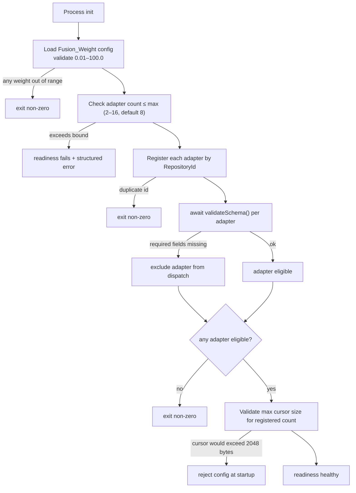
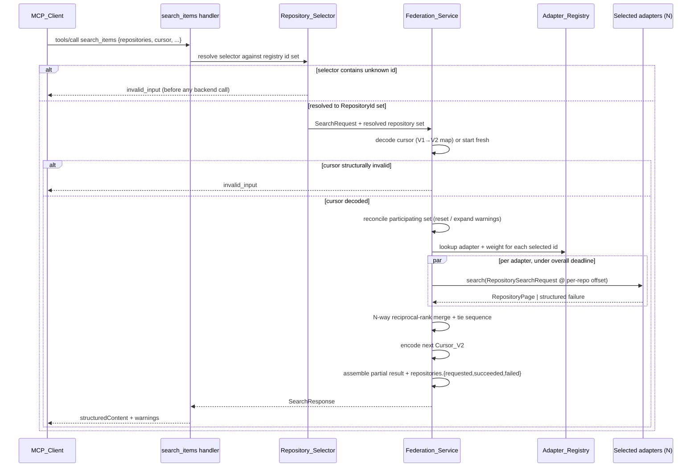

# Design Document: N-Repository Federation

## Overview

This design generalizes the JScholarship/JHRDR federation layer from a hardcoded two-repository pipeline into an N-repository layer driven by a runtime `Adapter_Registry`. The goal is that adding a third or fourth repository adapter (for example Sheridan Libraries digital collections via AM Quartex/IIIF) requires only a new adapter module plus configuration, with no edits to federation internals: the cursor codec, the reciprocal-rank merge, the tie-break sequence, partial-result assembly, and facet merging.

Scope is the federation machinery and the interfaces that connect adapters to it. The design does not define any specific third adapter, does not change the MCP tool surface, and does not alter the normalized data model or the per-adapter public-access enforcement model. The existing JScholarship and JHRDR adapters remain the initial registered set, and the generalization is backward compatible: V1 cursors still decode, existing tool inputs still validate, and with only `jscholarship` and `jhrdr` registered at equal weights the ordering, offsets, and warning codes match the current two-repository implementation.

This design builds on `.kiro/specs/jscholarship-jhrdr-mcp/` — particularly Requirements 1, 4, 6, 7, 8, 11, and 15 and the federation, ranking, and cursor sections of that design — and grounds its interfaces in the live code at `src/adapters/index.ts`, `src/federation/index.ts`, and `src/models/index.ts`.

### Requirement Mapping

| Concern | Requirements |
| --- | --- |
| Dynamic adapter registration | 1 |
| Generalized repository selector | 2 |
| Variable-length cursor | 3, 12 |
| N-way reciprocal-rank merge | 4 |
| N-way tie-break sequence | 5 |
| N-way partial-result assembly | 6 |
| N-way facet merging | 7 |
| Adapter contract stability | 8 |
| Backward compatibility | 9 |
| Configuration and limits | 10 |
| Observability for N repositories | 11 |

## Architectural Decisions

The v1 design wires exactly two adapters into the federation service and encodes pagination in a fixed-shape `FederatedCursorV1` (`jsOffset`, `dvOffset`, `nextTieSource`). Three structural pieces change; everything else is preserved.

| Decision | v1 (two-repository) | This design (N-repository) | Rationale |
| --- | --- | --- | --- |
| Adapter wiring | Static construction of two adapters, referenced by name in federation | `Adapter_Registry` resolves adapters by `RepositoryId`; federation holds no hardcoded ids | A new adapter registers at startup without touching merge, cursor, or dispatch code (Req 1.5) |
| Cursor shape | `FederatedCursorV1` with fixed `jsOffset`/`dvOffset`/`nextTieSource` | `Cursor_V2`: versioned, variable-length lexicographically-ordered offset map + participating id set + tie position | Pagination must work for any participating repository count without re-encoding the model (Req 3) |
| Merge arity | Two-pointer merge over two queues with `otherRepository` flip | N-way merge over a map of per-repository rank queues; tie position is a round-robin index into the sorted participating subset | No single large collection should dominate regardless of repository count (Req 4, Req 5) |
| Tie-break | Boolean alternation between two sources | Lexicographic round-robin over the participating subset, advance-and-wrap, carried in the cursor | Deterministic, balanced, order-independent of response arrival for any N (Req 5) |
| Selector | `all` or a single `RepositoryId` | `all`, single id, or a deduplicated array treated as a set; unknown id rejected before any backend call | Clients target any combination of registered repositories (Req 2) |
| Compatibility | — | V1 cursor decodes and maps to a V2 payload; schemas stay wire-compatible; equal-weight js+jhrdr ordering is identical | Existing clients, cursors, and workflows keep working unchanged (Req 9) |

Preserved from v1 without change: the `RepositoryAdapter` seam as the only place that knows Solr field names or constructs repository URLs; Solr-for-candidates / Canonical-API-for-truth; immutable public filters; field allowlists; indistinguishable not-found; namespaced record IDs; no cross-repository raw-score comparison; stateless federation via opaque cursor; fail-closed startup and dispatch; metadata-as-untrusted-data logging by allowlist.

## Architecture

### Component Layering

Nothing above the `src/adapters/index.ts` seam may know that Solr, DSpace, or Dataverse exist. The `Adapter_Registry` is the new indirection between the federation service and the concrete adapters.



The federation service resolves every adapter through the registry (Req 1.5). The MCP layer reads the registry's registered id set to advertise the `repositories` enum (Req 2.7) and to list adapters in `explain_search` (Req 9.5).

### Startup and Readiness



Registration completes before the readiness probe reports healthy (Req 1.1). Duplicate id, zero eligible adapters, or an out-of-range weight terminate the process with a non-zero exit code (Req 1.2, 1.4, 1.6). A schema-failing adapter is excluded but does not block others (Req 1.4, Req 8.7). If the configured registered count would produce cursors exceeding 2048 bytes, the configuration is rejected at startup rather than producing unusable cursors (Req 3.8).

### Federated Search Flow



## Components and Interfaces

All interfaces follow the workspace TypeScript conventions: explicit types, named interfaces for every object shape, meaningful generic type names, no `any`, two-space indent, 100-column lines.

### 1. Adapter Registry

The registry owns the mapping from `RepositoryId` to a registered adapter plus its resolved `Fusion_Weight` and eligibility. It is constructed once at startup and is immutable thereafter.

```ts
/** A positive reciprocal-rank weight, validated to 0.01–100.0 inclusive. */
export type FusionWeight = number;

/** Why an adapter is not eligible for dispatch, for diagnostics only. */
export type IneligibilityReason = "schema_validation_failed";

export interface RegisteredAdapter {
  readonly adapter: RepositoryAdapter;
  readonly weight: FusionWeight;
  readonly eligible: boolean;
  readonly ineligibleReason: IneligibilityReason | null;
}

export interface AdapterRegistration {
  readonly adapter: RepositoryAdapter;
  /** Omitted weight defaults to 1.0 (equal weighting). */
  readonly weight?: FusionWeight;
}

export interface AdapterRegistry {
  /** All registered ids, lexicographically sorted, for enum + cursor + discovery. */
  registeredIds(): readonly RepositoryId[];
  /** Ids whose startup schema validation succeeded (dispatch-eligible). */
  eligibleIds(): readonly RepositoryId[];
  has(id: RepositoryId): boolean;
  get(id: RepositoryId): RegisteredAdapter | undefined;
  weightOf(id: RepositoryId): FusionWeight;
}

export interface RegistryBuildResult {
  readonly registry: AdapterRegistry;
  /** Non-null when the process must terminate with a non-zero exit code. */
  readonly fatalError: RegistryFatalError | null;
}

export type RegistryFatalErrorCode =
  | "duplicate_repository_id"
  | "no_adapter_registered"
  | "all_adapters_schema_invalid"
  | "weight_out_of_range"
  | "adapter_count_exceeds_max"
  | "cursor_size_bound_exceeded";

export interface RegistryFatalError {
  readonly code: RegistryFatalErrorCode;
  readonly message: string;
}

export async function buildRegistry(
  registrations: readonly AdapterRegistration[],
  limits: FederationLimits,
): Promise<RegistryBuildResult>;
```

`buildRegistry` performs weight validation, max-count enforcement, duplicate detection, schema validation, the all-fail check, and the cursor-size bound check in that order, returning a `fatalError` for any condition that must terminate the process (Req 1.1–1.6, Req 3.8, Req 10.1–10.2). The federation service depends only on `AdapterRegistry`; it never names a concrete id (Req 1.5).

### 2. Repository Selector

```ts
/** Wire form accepted on the `repositories` input parameter (Req 9.2, 9.6). */
export type RepositorySelector = "all" | RepositoryId | RepositoryId[] | undefined;

export interface SelectorResolution {
  /** Distinct, lexicographically-sorted ids to dispatch to. */
  readonly selected: readonly RepositoryId[];
}

export type SelectorRejectionCode = "unknown_repository";

export interface SelectorRejection {
  readonly code: SelectorRejectionCode;
  readonly unknownIds: readonly RepositoryId[];
  readonly message: string;
}

export function resolveSelector(
  selector: RepositorySelector,
  registry: AdapterRegistry,
): SelectorResolution | SelectorRejection;
```

Resolution rules (Req 2):

- `all` or omitted → every eligible adapter whose backend responded to the most recent health probe (Req 2.1).
- A single `RepositoryId` → that adapter only (Req 2.2).
- An array → deduplicated to a set, dispatched to the distinct ids (Req 2.3).
- Any id not in the registry → `SelectorRejection` with code `unknown_repository`; the request is rejected as invalid input before any backend call (Req 2.4).

Availability within the resolved set is handled downstream during dispatch: a targeted-but-unavailable adapter yields a per-repository warning when at least one other targeted adapter is available (Req 2.5), and a `backend_unavailable` tool error when every targeted adapter is unavailable (Req 2.6). The MCP registry advertises `registeredIds()` as the enum of each tool's `repositories` parameter so clients build valid selectors without a discovery call (Req 2.7).

### 3. Cursor_V2 Codec

`Cursor_V2` replaces the fixed `FederatedCursorV1` shape with a variable-length, lexicographically-ordered offset map plus the participating id set and a numeric tie-sequence position.

```ts
export const CURSOR_V2_VERSION = 2 as const;

/** The maximum encoded cursor size, in bytes, after base64url encoding. */
export const MAX_ENCODED_CURSOR_BYTES = 2048;

/** Upper bound on any per-repository offset (Req 3.3, 12.7). */
export const MAX_REPOSITORY_OFFSET = 1_000_000;

export interface CursorV2 {
  readonly v: 2;
  /** FNV-1a 64-bit lowercase hex of the normalized request (Req 3.1). */
  readonly queryHash: string;
  /**
   * Next unexamined Solr position per participating repository, ordered by
   * RepositoryId lexicographically for deterministic encoding (Req 3.1, 3.10).
   */
  readonly offsets: ReadonlyArray<readonly [RepositoryId, number]>;
  /** The set of participating RepositoryIds, lexicographically sorted (Req 3.1, 12.6). */
  readonly participating: readonly RepositoryId[];
  /** Round-robin index into `participating` for the next tie resolution (Req 3.1, 5.4). */
  readonly nextTieSequence: number;
}

export type AnyCursor = CursorV1 | CursorV2;

export interface CursorV1 {
  readonly v: 1;
  readonly queryHash: string;
  readonly jsOffset: number;
  readonly dvOffset: number;
  readonly nextTieSource: RepositoryId;
}

/** Encode canonical JSON then base64url without padding (Req 12.1, 12.5). */
export function encodeCursorV2(cursor: CursorV2): string;

export type CursorDecodeErrorCode =
  | "malformed_encoding"
  | "unsupported_version"
  | "invalid_structure"
  | "offset_out_of_range"
  | "query_hash_format";

export interface CursorDecodeResult {
  /** Normalized to V2; a decoded V1 token is mapped here (Req 9.1). */
  readonly cursor: CursorV2 | null;
  /** Non-null only when the token must be rejected as invalid input. */
  readonly error: CursorDecodeErrorCode | null;
}

/**
 * Decode a transport string to a CursorV2. A V1 token is accepted and mapped
 * (jsOffset→jscholarship, dvOffset→jhrdr, nextTieSource→tie position). A
 * structurally corrupt, unsupported-version, or out-of-range token yields an
 * `error` so the caller rejects it before any backend call (Req 3.3, 3.4, 12.7).
 */
export function decodeCursor(encoded: string): CursorDecodeResult;
```

**Encoding.** The payload is serialized as canonical JSON (object keys sorted, `undefined` dropped) and base64url-encoded without padding, using only `A–Z a–z 0–9 - _` (Req 12.1, 12.5). Because `offsets` and `participating` are lexicographically ordered, equivalent state always encodes to the same bytes (Req 3.1, 12.4). The encoder asserts the result does not exceed `MAX_ENCODED_CURSOR_BYTES` (Req 3.8, 12.5).

**Decode validation.** Decoding validates: base64url decodes cleanly; `v` is a supported version; `queryHash` matches `^[0-9a-f]{16}$`; every id in `offsets`/`participating` is currently registered; every offset is a non-negative integer `≤ MAX_REPOSITORY_OFFSET` (Req 3.3, 12.7). Any failure returns a `CursorDecodeErrorCode` and the request is rejected without querying a backend (Req 3.4, 12.7).

**Participating-set reconciliation** (performed after a clean decode, before dispatch):

- A cursor id no longer registered → reset pagination to the first page with a `cursor_reset` warning whose reason is that the repository set changed (Req 3.5).
- A selected id missing an offset (adapter added between pages) → start that repository from offset zero with a `cursor_expanded` warning (Req 3.6).
- `queryHash` ≠ the current normalized request hash → reset all offsets to zero, return first-page results, and emit `cursor_reset` (Req 3.7, 12.8).

**V1 → V2 mapping** (Req 9.1): a decoded V1 token maps `jsOffset → jscholarship`, `dvOffset → jhrdr`, and `nextTieSource` to the round-robin position of that id within the sorted participating subset (`jhrdr` → 0, `jscholarship` → 1 for the two-repo subset). If the V1 query hash does not match the current request, pagination resets to the first page with a `cursor_reset` warning.

**Offset semantics** (Req 3.10, 12.3): each per-repository offset is the next unexamined Solr position, computed as the page's starting offset plus the number of candidates consumed (passed + failed + timed-out) during that page attempt — unchanged from v1, now carried per id.

### 4. Federation Service and N-Way Merge

The merge generalizes v1's two-pointer merge to a map of per-repository rank queues. Each adapter still returns a `RepositoryPage` (unchanged shape) carrying records with 1-based `sourceRank`.

```ts
export interface FusionConfig {
  /** RRF constant k, integer 1–1000, default 60 (Req 4.2). */
  readonly k: number;
  /** Resolved weight per participating repository (Req 1.6, 4.2). */
  readonly weights: ReadonlyMap<RepositoryId, FusionWeight>;
}

export interface MergeInput {
  readonly pages: ReadonlyMap<RepositoryId, RepositoryPage>;
  readonly participating: readonly RepositoryId[];
  readonly cursor: CursorV2 | null;
  readonly limit: number;
  readonly fusion: FusionConfig;
  readonly queryHash: string;
}

export interface MergeResult {
  readonly results: readonly RepositoryRecord[];
  readonly nextCursor: CursorV2 | null;
  readonly warnings: readonly RepositoryWarning[];
}

export function mergePages(input: MergeInput): MergeResult;
```

Merge algorithm (Req 4):

1. Preserve each adapter's `sourceRank` as a 1-based position in its validated list; never compare raw relevance scores across repositories (Req 4.1).
2. For each head record compute `fusionScore = weightOf(repository) / (k + sourceRank)` (Req 4.2).
3. Repeatedly take the head with the greatest fusion score across all non-empty queues, appending to the merged list until `limit` is reached or all queues drain (Req 4.3).
4. On an equal-score tie, apply the `Tie_Sequence` (Component 5) to choose the winner, then the ascending namespaced id as the final deterministic tiebreak (Req 4.4, 5.7).
5. Stamp `sourceRank` and `repository` on every emitted record (Req 4.6).

Passthrough cases that skip fusion scoring:

- Exactly one repository selected → preserve that adapter's native ordering (Req 4.7).
- Multiple selected but only one returned results (backend failure) → preserve the responding adapter's native ordering and emit a warning naming the unavailable repository (Req 4.8).

The federated rank is never labeled a probability, confidence, or cross-repository relevance score (Req 4.5).

### 5. N-Way Tie Sequence

The tie sequence is a round-robin over the participating subset, derived purely from the lexicographic order of participating ids so it is independent of registration order and of response arrival order.

```ts
export interface TieSequence {
  /** Participating ids in lexicographic order; the round-robin ring (Req 5.1, 5.5). */
  readonly order: readonly RepositoryId[];
  /** Current position in `order` (0-based); carried in the cursor (Req 5.4). */
  readonly position: number;
}

export function deriveTieSequence(
  participating: readonly RepositoryId[],
  startPosition: number,
): TieSequence;

/** The repository preferred at the current position (Req 5.2). */
export function tieWinner(sequence: TieSequence): RepositoryId;

/** Advance one step, wrapping to 0 after the last id (Req 5.3). */
export function advanceTie(sequence: TieSequence): TieSequence;
```

Rules (Req 5):

- `order` is the participating ids sorted lexicographically, re-derived from the selected subset when only a subset is queried (Req 5.1, 5.5).
- On a tie, the repository at `position` wins (Req 5.2); after resolution `position` advances by one, wrapping to zero after the last id (Req 5.3).
- `position` is seeded from the cursor's `nextTieSequence` and initialized to zero for a new query (Req 5.4).
- When the tie sequence points at a repository that is not one of the two tied contributors, the tie is resolved among the tied contributors by their position offset within `order` (nearest forward in the ring), keeping resolution deterministic and order-independent of arrival (Req 5.6).
- When both tied records would map to the same repository preference, the namespaced record id is the final stable tiebreak (Req 5.7).

### 6. N-Way Partial-Result Assembly

```ts
export type AdapterOutcome = "success" | "error" | "timeout";

export interface AdapterResult {
  readonly repository: RepositoryId;
  readonly outcome: AdapterOutcome;
  readonly page: RepositoryPage | null;
  /** Machine-readable failure code; no endpoints or stack traces (Req 6.2). */
  readonly failureCode: AdapterFailureCode | null;
}

export type AdapterFailureCode =
  | "backend_unavailable"
  | "deadline_exceeded"
  | "validation_attrition"
  | "schema_excluded";

export interface PartialAssembly {
  readonly response: SearchResponse;
  readonly isError: boolean;
}

export function assemblePartial(options: {
  readonly requested: readonly RepositoryId[];
  readonly results: readonly AdapterResult[];
  readonly mergeResult: MergeResult;
  readonly encodedCursor: string | null;
}): PartialAssembly;
```

Behavior (Req 6):

- When at least one adapter succeeds and one or more fail, return a partial result with results from all successful adapters (Req 6.1), one repository-qualified warning per failure carrying the id and a machine-readable code but no endpoints/exception text/stack traces (Req 6.2).
- Populate `repositories.requested`, `repositories.succeeded`, and `repositories.failed` (Req 6.3).
- When every selected adapter fails, return a structured MCP tool error with `isError: true` rather than an empty success (Req 6.4).
- The emitted cursor contains offsets only for contributing repositories; a failed repository's offset is omitted so the next page re-attempts it from its last recorded offset, or from zero if none (Req 6.5, 6.6).
- When the overall tool deadline is reached after at least one adapter returned validated results but before all responded, return a partial result from the completed adapters with a warning naming each timed-out repository (Req 6.7, 10.6).
- When an adapter's Canonical API becomes unavailable after it already validated one or more candidates this page, include those validated results and emit a `validation_attrition` warning for that repository (Req 6.8).

The `RepositoryWarning.code` union is extended with `cursor_expanded`, `deadline_exceeded`, and `validation_attrition` (additive only; see Backward Compatibility).

### 7. N-Way Facet Merging

```ts
export interface RepositoryFacetContribution {
  readonly repository: RepositoryId;
  readonly facets: readonly FacetResult[];
  readonly totalMatches: number;
  readonly supported: ReadonlySet<CommonFacet>;
}

export interface MergedFacetValue {
  readonly label: string;
  readonly count: number;
  readonly repositoryBreakdown: Partial<Record<RepositoryId, number>>;
}

export function mergeFacets(
  contributions: readonly RepositoryFacetContribution[],
): FacetResult[];
```

Rules (Req 7):

- Collect facet responses from all participating adapters; merge values that normalize to the same label after case-folding, whitespace collapsing, and removal of hyphens, parentheses, and trailing periods (Req 7.1).
- Sum merged counts and report a per-repository breakdown alongside the merged total (Req 7.2).
- Choose the display label as the most frequent original form across contributing repositories; ties in frequency break to the form that sorts first in ascending Unicode order (Req 7.3).
- Return at most 10 values per facet, ordered by merged count descending then display label ascending (Req 7.4).
- Include a `repository` facet whose values are the participating RepositoryIds with their Solr candidate counts for the current query and public filters (Req 7.5).
- A facet unsupported by one adapter uses values from supporting adapters only, never treated as an error (Req 7.6).
- If every participating adapter fails to return facet data, return a structured backend-unavailability error with no internal endpoints or exception details (Req 7.7).

### 8. Adapter Contract (Versioned, Stable)

The contract matches the live `RepositoryAdapter` in `src/adapters/index.ts` and is pinned by a contract version so a breaking change is a compile-time error rather than a runtime failure (Req 8.6).

```ts
/** Bump on any breaking change to the adapter contract (Req 8.6). */
export const ADAPTER_CONTRACT_VERSION = 2 as const;

export interface RepositoryAdapter {
  readonly id: RepositoryId;
  /** Declares the contract version this adapter implements (Req 8.6). */
  readonly contractVersion: typeof ADAPTER_CONTRACT_VERSION;

  validateSchema(): Promise<SchemaValidationResult>;
  search(request: RepositorySearchRequest): Promise<RepositoryPage>;
  get(identifier: RepositoryIdentifier, options?: GetOptions): Promise<ItemDetail | null>;
  facets(request: RepositoryFacetRequest): Promise<RepositoryFacets>;
  related(source: ItemDetail, request: RelatedRequest): Promise<RepositoryPage>;
  /** Public-access revalidation probe for cache revalidation (Req 8.5). */
  probePublic(record: RepositoryRecord): Promise<boolean>;
}
```

Contract invariants (Req 8):

- `search`, `get`, `facets`, `related`, and `validateSchema` input/output types contain no Solr field names, repository-specific URLs, or platform API structures (Req 8.1).
- No adapter imports, references, or receives another adapter or the federation merge logic (Req 8.2).
- `RepositoryPage` carries: `repository`, validated `results` with 1-based `sourceRank` (length ≤ requested limit), `nextOffset` (null when Solr returned fewer candidates than requested), `totalCandidates`, `validationOmissions`, and `warnings` (Req 8.3).
- Each adapter performs its own public-access validation inside `search`, `get`, and `related`; the federation service performs no access checks on adapter results (Req 8.4).
- `probePublic` accepts a record and returns a boolean for cache revalidation (Req 8.5). It is promoted from optional (v1) to required in contract version 2; this is additive to the implemented adapters, which already provide it.
- A backend that is unreachable or returns a non-transient error during `search`, `get`, `facets`, or `related` yields a structured failure with the id and a machine-readable code, no internal endpoints or exception details (Req 8.8).
- `validateSchema` returns a `SchemaValidationResult` with a success/failure status, confirmed required fields, and missing required fields so the federation service decides dispatch eligibility without interpreting platform schema responses (Req 8.9). A missing-required result excludes the adapter and surfaces a warning when a client selects it (Req 8.7).

### 9. MCP Surface Touchpoints

The tool surface is unchanged. Two existing tools read the registry:

- The `repositories` input parameter's JSON Schema advertises `registeredIds()` as an enum and additionally accepts an array of those ids (Req 2.7, 9.6). The `all`, single-string, and omitted forms stay valid without modification (Req 9.2, 9.6).
- `explain_search` lists every registered adapter's `RepositoryId` and human-readable description (Req 9.5).

## Data Models

### Configuration and Limits

```ts
export interface FederationLimits {
  /** Max registered adapters, 2–16 inclusive, default 8 (Req 10.1). */
  readonly maxAdapters: number;
  /** RRF k, 1–1000 inclusive, default 60 (Req 4.2). */
  readonly rrfK: number;
  /** Total canonicalization budget in candidates, default 150 (Req 10.3). */
  readonly canonicalizationBudget: number;
  /** Overall tool deadline in ms, 1000–10000 inclusive, default 10000 (Req 10.5). */
  readonly deadlineMs: number;
}

export interface WeightConfig {
  /** Per-repository weight, 0.01–100.0 inclusive; absent → 1.0 (Req 1.6, 10.2). */
  readonly weights: ReadonlyMap<RepositoryId, FusionWeight>;
}
```

Limit enforcement (Req 10):

- Max adapter count is enforced at startup; exceeding the bound fails readiness and logs a structured error event (Req 10.1).
- Each weight is validated as a positive finite number `≤ 100` at startup; zero, negative, non-finite, or over-bound fails readiness (Req 10.2).
- The sum of per-repository over-fetch ceilings (`3 × limit × selectedCount`) is validated against the canonicalization budget (default 150) per request (Req 10.3). When the budget would be exceeded, per-repository fetch windows are reduced proportionally to configured weights so the windows sum to the budget (Req 10.4).

```ts
/** Proportional window allocation under the canonicalization budget (Req 10.4). */
export function allocateFetchWindows(options: {
  readonly selected: readonly RepositoryId[];
  readonly limit: number;
  readonly weights: ReadonlyMap<RepositoryId, FusionWeight>;
  readonly budget: number;
}): ReadonlyMap<RepositoryId, number>;
```

- The overall tool deadline (default 10s) applies regardless of fan-out; exceeding it yields a partial result with a `deadline_exceeded` warning when results exist, or a structured tool error otherwise (Req 10.5, 10.6).
- A CloudWatch metric records dispatch fan-out (adapters called per request); an alarm triggers when fan-out on any single request `≥ 75%` of the configured max adapter count (Req 10.7).

### Observability Model

The per-invocation log and metrics generalize from the fixed two-repository shape to a per-repository collection, with the repository id as the metric dimension.

```ts
export interface RepositoryTelemetry {
  readonly repository: RepositoryId;
  readonly latencyMs: number;
  readonly resultCount: number;
  readonly validationOmissions: number;
  readonly outcome: "success" | "partial" | "error";
}

export interface FederatedInvocationLog {
  readonly timestamp: string;
  readonly requestId: string;
  readonly tool: string;
  readonly totalAdapters: number;
  readonly respondingAdapters: number;
  readonly perRepository: readonly RepositoryTelemetry[];
  readonly outcome: "success" | "partial" | "error";
}
```

Observability rules (Req 11):

- Every invocation log carries per-repository latency (ms), result count, validation omission count, and outcome (Req 11.1), plus total and responding adapter counts (Req 11.3).
- Per-repository CloudWatch metrics (invocation count; p50/p95/p99 latency; error rate; validation omission rate; availability) use the repository id as a metric dimension (Req 11.2).
- No repository-specific query text, filter values, or response content is ever logged, regardless of repository count — enforced by the existing deny-by-default serializer in `src/observability/index.ts` (Req 11.4).
- A newly registered adapter is automatically included in per-repository metric dimensions, deriving the dimension value from its id with no manual metric configuration (Req 11.5).
- Metric emission failure is non-fatal: processing continues, the failure is logged locally, and no error is returned to the client (Req 11.6).

## Error Handling

| Condition | Handling | Requirement |
| --- | --- | --- |
| Duplicate `RepositoryId` at startup | Terminate process, non-zero exit | 1.2 |
| No adapter registered / all schema-invalid | Terminate process, non-zero exit | 1.2, 1.4 |
| Weight outside 0.01–100.0 | Fail readiness / non-zero exit | 1.6, 10.2 |
| Adapter count over max | Fail readiness, structured error log | 10.1 |
| Registered count would exceed 2048-byte cursor | Reject config at startup | 3.8 |
| Selector names unknown id | `invalid_input`, before any backend call | 2.4 |
| Some targeted adapters unavailable, ≥1 available | Partial result + per-repo warning (no endpoints) | 2.5, 6.1–6.3 |
| All targeted adapters unavailable | `backend_unavailable` tool error | 2.6, 6.4 |
| Cursor malformed/unsupported/out-of-range | `invalid_input`, before any backend call | 3.4, 12.7 |
| Cursor id no longer registered | Reset to first page + `cursor_reset` | 3.5 |
| Cursor missing offset for newly selected id | Start that repo at 0 + `cursor_expanded` | 3.6 |
| Cursor query hash mismatch | Reset offsets to 0 + `cursor_reset` | 3.7, 12.8 |
| Overall deadline exceeded, ≥1 result | Partial result + `deadline_exceeded` | 6.7, 10.6 |
| Canonical API drops mid-page after ≥1 validated | Include validated results + `validation_attrition` | 6.8 |
| All adapters fail facets | Structured backend-unavailability error | 7.7 |
| CloudWatch metric emission fails | Log locally, continue, no client error | 11.6 |

All client-visible warnings and errors carry a machine-readable code and fixed human-readable text; no internal endpoint, hostname, exception text, or stack trace reaches the client, matching the v1 fail-closed posture (Req 2.5, 2.6, 6.2, 8.8).

## Testing Strategy

Property-based testing is the primary verification mechanism for the federation machinery, consistent with `AGENTS.md` (property suites in `test/property/`, at least 100 generated cases per property using `fast-check`). The cursor codec, N-way merge, and tie sequence are pure functions over structured input and are strong PBT targets: they have round-trip, determinism, and fairness invariants that hold across a large input space (1–8 repositories, arbitrary offsets, arbitrary rank lists).

**Property tests** (`test/property/`) implement each Correctness Property below as a single `fast-check` property configured for ≥100 runs, each tagged `Feature: n-repository-federation, Property {n}: {text}`. Generators cover 1–8 participating repositories, offsets in `0..1_000_000`, weights in `0.01..100.0`, and rank-ordered record lists with colliding fusion scores to exercise ties.

**Unit tests** (`test/unit/`) cover concrete examples and edge cases that PBT complements rather than replaces: the V1→V2 mapping for the exact two-repository token, the registry fatal-error cases (duplicate id, empty registry, all-schema-invalid, out-of-range weight, over-max count, cursor-size bound), selector resolution for `all`/single/array/unknown, proportional window allocation at the budget boundary, and facet label normalization examples.

**Integration tests** (`test/integration/`) assert backward compatibility against the assembled server: a stored V1 cursor paginates correctly; existing `repositories` inputs (`all`, single string, omitted) validate unchanged; and with only `jscholarship` and `jhrdr` registered at equal weights, result ordering, cursor offsets, and warning codes match the current two-repository implementation (excluding `retrievedAt` and cursor encoding format, per Req 9.3).

Facet merging, configuration/limit enforcement, and observability are verified by example-based unit tests and integration assertions rather than PBT: facet merge is better pinned by concrete normalization examples, limits are boundary checks, and observability is a side-effect (metric/log emission) verified with mocks and the deny-by-default serializer's existing guarantees.

## Correctness Properties

*A property is a characteristic or behavior that should hold true across all valid executions of a system — essentially, a formal statement about what the system should do. Properties serve as the bridge between human-readable specifications and machine-verifiable correctness guarantees.*

### Property 1: Cursor round-trip identity

*For any* `CursorV2` payload containing 1 through 8 per-repository offsets with valid ids and offsets, encoding then decoding SHALL produce a payload whose field values (version, query hash, offset map, participating set, tie position) are identical to the original.

**Validates: Requirements 3.1, 12.1**

### Property 2: Cursor encoding alphabet and size bound

*For any* `CursorV2` payload with up to 8 offsets, the encoded string SHALL contain only base64url characters (`A–Z a–z 0–9 - _`) with no padding and SHALL NOT exceed 2048 bytes.

**Validates: Requirements 3.8, 12.5**

### Property 3: Query hash sensitivity

*For any* two search requests that differ in normalized query text, selected repositories, filters (after array sorting and default omission), sort, or limit, the computed query hashes SHALL differ; and *for any* two requests equivalent after normalization, the hashes SHALL be identical.

**Validates: Requirements 3.9, 12.2**

### Property 4: Decode rejects invalid tokens before backend

*For any* transport string that fails base64url decoding, carries an unsupported version, contains a non-integer or negative offset, contains an offset greater than 1,000,000, or fails structural type validation, decoding SHALL return a rejection with no backend dispatch.

**Validates: Requirements 3.3, 3.4, 12.7**

### Property 5: Offset computation

*For any* page attempt with a starting offset and a number of candidates consumed (passed + failed + timed-out), the returned per-repository offset SHALL equal the starting offset plus the candidates consumed.

**Validates: Requirements 3.10, 12.3**

### Property 6: Participating set carried in payload

*For any* federated query over a subset of registered repositories, the emitted cursor's `participating` set SHALL equal the set of repositories that participated, so set-change detection depends only on the cursor payload.

**Validates: Requirements 3.1, 12.6**

### Property 7: Merge determinism under reordering

*For any* set of per-repository result pages and a fixed tie-sequence position, merging SHALL produce identical result ordering regardless of the order in which adapter responses are supplied to the merge.

**Validates: Requirements 4.3, 5.6**

### Property 8: Fusion score ordering

*For any* merged result list, each record's fusion score computed as `weight / (k + sourceRank)` SHALL be greater than or equal to the fusion score of the record that follows it, except where a tie is resolved by the tie sequence or namespaced id.

**Validates: Requirements 4.2, 4.3**

### Property 9: Single-responder passthrough

*For any* query where exactly one repository is selected, or where multiple are selected but only one returns results, the merged ordering SHALL equal that responding adapter's native ordering with no fusion re-ranking applied.

**Validates: Requirements 4.7, 4.8**

### Property 10: Every result carries source attribution

*For any* merged result list, every record SHALL carry a `sourceRank` and a `repository` field identifying its contributing adapter.

**Validates: Requirements 4.6**

### Property 11: Tie-sequence fairness and advance

*For any* participating subset of size N and any sequence of T consecutive ties, the tie sequence SHALL select repositories by lexicographic round-robin, advancing one position per tie and wrapping after the last, so that over N consecutive ties each repository is selected exactly once.

**Validates: Requirements 5.1, 5.2, 5.3**

### Property 12: Tie-sequence subset re-derivation

*For any* selected subset of registered repositories, the tie-sequence ordering SHALL be the lexicographic order of exactly that subset, independent of registration order and of the full registered set.

**Validates: Requirements 5.1, 5.5**

### Property 13: Final namespaced-id tiebreak

*For any* two tied records that the tie sequence maps to the same repository preference, the record with the lexicographically smaller namespaced id SHALL be ordered first.

**Validates: Requirements 5.7, 4.4**

### Property 14: Partial-result cursor omits failed repositories

*For any* federated page where a subset of adapters fail, the emitted cursor SHALL contain offsets only for repositories that contributed results, so a subsequent page re-attempts each failed repository from its last recorded offset or from zero.

**Validates: Requirements 6.5, 6.6**

### Property 15: Selector deduplication

*For any* array-valued repository selector, the resolved dispatch set SHALL be the distinct ids of the array (treated as a set), with no repository dispatched more than once.

**Validates: Requirements 2.3**

### Property 16: V1 cursor maps to equivalent V2 state

*For any* valid V1 cursor whose query hash matches the current request, decoding SHALL produce a V2 cursor whose `jscholarship` offset equals the V1 `jsOffset`, whose `jhrdr` offset equals the V1 `dvOffset`, and whose tie position corresponds to the V1 `nextTieSource`.

**Validates: Requirements 9.1**

### Property 17: Facet count conservation

*For any* collection of per-repository facet contributions, each merged facet value's total count SHALL equal the sum of its per-repository breakdown counts, and the breakdown SHALL name only participating repositories.

**Validates: Requirements 7.2**

### Property 18: Proportional window allocation sums to budget

*For any* selected repository set whose unconstrained over-fetch ceilings exceed the canonicalization budget, the allocated per-repository fetch windows SHALL sum to the budget and SHALL be allocated in proportion to configured fusion weights.

**Validates: Requirements 10.3, 10.4**
