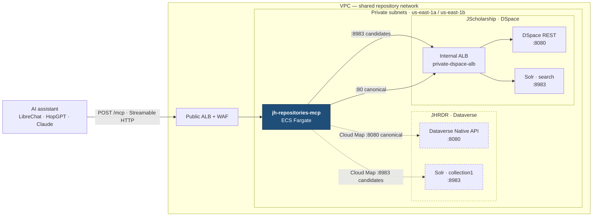

# jh-repositories-mcp

A read-only [Model Context Protocol](https://modelcontextprotocol.io) server that
gives AI research assistants one federated search interface over two independently
operated Johns Hopkins repositories:

- **JScholarship** — the institutional repository (theses, articles, reports), on
  DSpace, indexed by a SolrCloud `search` collection and resolved through DSpace REST.
- **JHRDR** — the Johns Hopkins Research Data Repository (datasets), on Dataverse,
  indexed by Solr `collection1` and resolved through the Dataverse Native API.

Different platforms, different metadata models, different notions of "published."
A researcher asking *"what has Hopkins published on X, and is there data I can
reuse?"* shouldn't have to know any of that.

Strict TypeScript on [Bun](https://bun.sh), with [Hono](https://hono.dev) and the
MCP TypeScript SDK's Web Standard Streamable HTTP transport, deployed as ECS
Fargate tasks.

## New here?

This repo ships its own onboarding guide as a Claude Code skill:
[`.claude/skills/jh-repo-mcp-onboarding/`](.claude/skills/jh-repo-mcp-onboarding/SKILL.md).
Open the repo in Claude Code and ask for a walkthrough — you'll get a staged tour
that starts by verifying your toolchain, teaches the invariants in the order they
build on each other, and stops to check that each one landed. It also works as an
architecture reference, and as a pattern guide if you're building another MCP
server on the same bones.

[`ONBOARDING.md`](ONBOARDING.md) shows how to set up the skill (in this repo, from
another project, or in Claude.ai), how to get the most out of it, and how to use
it to build a new MCP server.

Prefer to read? The **developer reference** at
<https://jhu-library-devops.github.io/jh-repositories-mcp/> (source in
[`docs/`](docs/index.md)) covers the MCP surface, configuration, architecture,
and how to extend and operate the service. [`CONTEXT.md`](CONTEXT.md) defines the
domain vocabulary, and
[ADR-005](docs/adr/ADR-005-solr-candidates-canonical-api-gate.md) records the
decision everything else follows from.

## The one idea

> **Solr finds candidates. The canonical API decides truth.**

On an uncached search, each adapter queries its private Solr collection for
candidates, then re-fetches each selected candidate through the platform's public
API as an anonymous caller. A candidate that fails that gate is silently dropped,
and no Solr-sourced metadata reaches a client. Direct-item cache hits are
re-probed before return. The current bounded search cache reuses pages validated
when first cached, although Requirement 15.4 requires cached candidates to pass
fresh canonical validation before return; this is known implementation drift.

The Solr indexes are internal, they lag the platforms, and their copies of
access-control fields have drifted from what the platforms actually enforce.
Treating the index as the authority means eventually publishing a withdrawn
thesis. So the whole architecture is built around one guarantee: **never disclose
a record that isn't public, and never let a client infer that one exists.**
Most of what looks over-engineered here is downstream of that.

## Topology

Everything runs in one VPC. The MCP tasks attach ENIs to the same private subnets
as both repository deployments, so there's a direct network path to each with no
NAT and no peering, and east-west traffic stays on plain HTTP.



Two hops per repository, and the split is the architecture: the **Solr** edge
finds candidates, the **canonical API** edge decides which of them are real and
public. DSpace is reached through an internal ALB that fronts both its REST API
and its Solr collection; Dataverse is reached directly through Cloud Map service
discovery.

The dashed JHRDR path is documented but not yet validated against live
infrastructure — see [`docs/spike/endpoint-routes.md`](docs/spike/endpoint-routes.md)
for DNS names, ports, health paths, security group rules, and the open questions
on the Dataverse side.

## MCP surface

Closed and fixed: no dynamic registration, strict schemas throughout. Full
schemas are in the [MCP surface reference](docs/reference/mcp-surface.md).

<!-- docs:inject mcp-surface-summary -->
| Type | Name | Purpose |
| --- | --- | --- |
| Tool | `search_items` | Search JScholarship (publications) and/or JHRDR (research datasets) with structured filters and cursor pagination. Returns citation-ready public records only. |
| Tool | `get_item` | Resolve one public record by namespaced ID, UUID, Handle, DOI, or Dataverse persistent identifier, with full canonical metadata and public file summaries. |
| Tool | `list_facets` | List approved facets (repository, creator, subject, year, resourceType, collection) with per-repository counts for refining a search. |
| Tool | `find_related_items` | Find public records related to a known publication or dataset, within or across the two repositories. |
| Tool | `explain_search` | Explain how a search would be interpreted per repository (concepts searched, filters applied or unsupported, sort) without executing it. |
| Resource | `jhu-repo://jscholarship/item/{encodedIdentifier}` | Canonical public JScholarship record by encoded identifier |
| Resource | `jhu-repo://jhrdr/dataset/{encodedIdentifier}` | Canonical public JHRDR dataset by encoded identifier |
| Prompt | `explore_research_topic` | Iteratively explore JHU repository holdings (publications and datasets) on a research topic, with citations to persistent identifiers. |
| Prompt | `find_reusable_data` | Discover and evaluate reusable JHRDR datasets for a research need, including related JScholarship publications. |
<!-- /docs:inject -->

v1 is deliberately narrow: anonymous, read-only, no embedded LLM, no vector
search, no writes, no file-content proxying. Adding to this list is a spec change,
not a feature PR.

## Quick start

```bash
bun install --frozen-lockfile   # honors .bun-version and the committed bun.lock
bun run typecheck               # tsc --noEmit — the bundler does not type-check
bun test                        # unit, property, contract, integration
bun run lint                    # biome check .
```

Then start it. Config validation is fail-fast, so `bun run dev` with no
environment will exit and list everything it needs at once:

```bash
ENVIRONMENT=stage BUILD_VERSION=dev BUILD_COMMIT=local \
JSCHOLARSHIP_SOLR_URL=http://localhost:8983/solr/search \
JSCHOLARSHIP_API_URL=http://localhost:8080/server/api \
JSCHOLARSHIP_PUBLIC_URL=https://jscholarship.library.jhu.edu \
ALLOWED_HOSTS=localhost:3000 \
bun run dev
```

`GET /health/live` reports process liveness. `GET /health/ready` stays 503 until
Solr schema validation confirms the index still has the fields each profile
depends on. (The deployed load balancer checks `/health/live`, so readiness is
reported, not enforced, in routing.) The JHRDR adapter is only
constructed when its Solr and API URLs are set, so leaving them unset runs the
service single-repository. Every variable and default is in the
[configuration reference](docs/reference/configuration.md).

## Layout

```
src/
  index.ts        Hono app, health routes, adapter wiring, startup schema validation
  mcp/            Transport, the closed tool/resource/prompt registry, tool handlers
  adapters/       The RepositoryAdapter seam, safe Solr query layer, canonical gate,
                  caching and retry, and one directory per platform
  federation/     Reciprocal-rank merge, opaque cursors, response assembly
  models/         Domain types, zod schemas, namespaced identifiers
  security/       Host and Origin validation, edge and deadline middleware, semaphore
  observability/  Allowlist-redacted logging, CloudWatch EMF metrics
config/repositories/   Repository profiles: field allowlists and immutable public filters
test/           unit, property, contract, integration, fixtures
infra/          OpenTofu — shared stack and per-environment service
```

[`src/adapters/index.ts`](src/adapters/index.ts) is the architectural seam.
Nothing above it — federation, tools, registry, transport — knows that Solr,
DSpace, or Dataverse exist.

## Documentation

| Where | What it's for |
| --- | --- |
| [Developer reference](https://jhu-library-devops.github.io/jh-repositories-mcp/) ([`docs/`](docs/index.md)) | MCP surface, configuration, repositories, errors, infrastructure, architecture, and guides. The reference pages are generated from source. |
| [`docs/adr/`](docs/adr/README.md) | Architecture decision records: why each structural choice was made |
| [`CONTEXT.md`](CONTEXT.md) | Domain vocabulary: the terms to use, and the ones to avoid |
| [`ONBOARDING.md`](ONBOARDING.md) | New-contributor setup and the onboarding skill |
| [`CONTRIBUTING.md`](CONTRIBUTING.md) | How to make a change: tests, fixtures, scope, commits, PRs |
| [`CLAUDE.md`](CLAUDE.md), [`AGENTS.md`](AGENTS.md) | Guidance for coding agents |
| [`.kiro/specs/`](.kiro/specs/) | Requirements, designs, and task plans (working records, not published) |
| [`docs/spike/`](docs/spike/) | Schema and network investigations (working records, not published) |

**Where a document and the source disagree, the source wins.** Fix the document.

## Contributing

See [`CONTRIBUTING.md`](CONTRIBUTING.md) for the full guide — the invariants to
check before changing behavior, what belongs in which test directory, fixture
sanitization, changelog fragments, and commit and PR conventions.

The short version: add tests with each behavior change, put invariants in
`test/property/` as generated cases, run `bun run docs:generate` when you change
the MCP surface, configuration, profiles, or errors, describe the change with a
`changelog.d/` fragment, and cite the requirement and task numbers your PR
advances. Never commit
credentials, private endpoints, or unreviewed repository payloads.

## Deployment

Multi-stage [`Dockerfile`](Dockerfile) on Bun, running non-root. Infrastructure is
OpenTofu in [`infra/`](infra/) — a shared stack (IAM, ALB, WAF) plus a per-environment
service, one MCP service per environment. CI in
[`.github/workflows/`](.github/workflows/) runs lint, typecheck, test, build, and a
dependency audit, with separate build-push, deploy, infra-validate, and smoke-test
workflows.

Post-deployment verification:

```bash
./scripts/smoke-test.sh https://mcp-stage.library.jhu.edu
```

## License

[Eclipse Public License 2.0](LICENSE).
