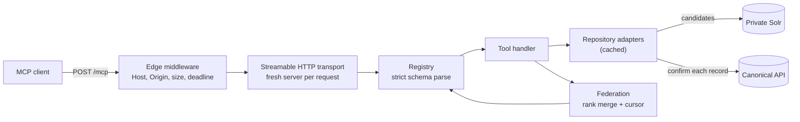

# Architecture overview

`jh-repositories-mcp` is a stateless HTTP service. It accepts MCP requests, searches each repository's private Solr index for candidates, confirms every candidate through that repository's public API, and returns the confirmed records merged into one ranked list.

The guarantee the design protects: **never disclose a record that isn't public, and never let a client infer that one exists.** The [canonical gate](./canonical-gate.md) is how.

## Runtime

| Concern | Choice | Decision |
| --- | --- | --- |
| Language and runtime | Strict TypeScript on a pinned Bun release | [ADR-002](../adr/ADR-002-pinned-bun-with-strict-typescript.md) |
| HTTP and MCP transport | Hono with the MCP SDK's Web Standard Streamable HTTP transport | [ADR-003](../adr/ADR-003-hono-with-mcp-sdk-web-standard-transport.md) |
| Session model | Stateless; JSON responses; continuation state in the cursor | [ADR-006](../adr/ADR-006-stateless-mcp-streamable-http.md) |
| Access model | Anonymous and read-only | [ADR-008](../adr/ADR-008-anonymous-read-only-v1.md) |
| Synthesis | Done by the host model, not by this server | [ADR-009](../adr/ADR-009-host-model-performs-synthesis.md) |
| Deployment | ECS Fargate, one service per environment | [ADR-001](../adr/ADR-001-one-mcp-service-per-environment.md) |

## Request path



1. **Edge** (`src/security/index.ts`). Every `/mcp` request gets an `x-request-id`, an exact `Host` allowlist check, an `Origin` check when the header is present, a `Content-Length` bound, and an overall deadline. See [Security](./security.md).
2. **Transport** (`src/mcp/transport.ts`). Only `POST` is served. Each request gets a new MCP server and transport with no session ID, so any task can serve any request. `GET` and `DELETE` return 405.
3. **Registry** (`src/mcp/registry.ts`). A closed, static table of five tools, two resource templates, and two prompts. Arguments are parsed with strict zod schemas before a handler runs; unknown properties are rejected, not stripped. A tool-concurrency semaphore bounds in-flight calls.
4. **Tool handlers** (`src/mcp/tools/`). Select repositories, fan out to adapters with `Promise.allSettled` so one failing repository yields a [partial result](../reference/errors.md#warning-codes) rather than an error, then hand the per-repository pages to federation.
5. **Adapters** (`src/adapters/`). Translate MCP concepts into allowlisted Solr queries, then run the canonical gate. Wrapped by `withCaching`.
6. **Federation** (`src/federation/index.ts`). Merges repository-local rankings and encodes the cursor. See [Federation and pagination](./federation.md).
7. **Rendering**. Each tool result carries `structuredContent`, a compact text rendering, and `resource_link` entries for the returned records.

`get_item` skips Solr and federation: it resolves one identifier directly through the canonical API. Resource reads (`jhu-repo://…`) parse the URI and call the same `get_item` handler, so there is one code path to a single record.

## The adapter seam

`RepositoryAdapter` in `src/adapters/index.ts` is the architectural boundary.

```ts
export interface RepositoryAdapter {
  readonly id: RepositoryId;
  validateSchema(): Promise<SchemaValidationResult>;
  search(request: RepositorySearchRequest): Promise<RepositoryPage>;
  get(identifier: RepositoryIdentifier, options?: GetOptions): Promise<ItemDetail | null>;
  facets(request: RepositoryFacetRequest): Promise<RepositoryFacets>;
  related(source: ItemDetail, request: RelatedRequest): Promise<RepositoryPage>;
  probePublic?(record: RepositoryRecord): Promise<boolean>;
}
```

Solr field names, platform URLs, and platform access rules live below this interface. Nothing above it (federation, tools, registry, transport) knows that Solr, DSpace, or Dataverse exist.

Each platform implements the interface separately ([ADR-004](../adr/ADR-004-two-platform-specific-adapters.md)). There is no shared `isPublic()`, because "public" means different things on each platform:

| Aspect | JScholarship (`src/adapters/jscholarship/`) | JHRDR (`src/adapters/jhrdr/`) |
| --- | --- | --- |
| Platform | DSpace | Dataverse |
| Public means (canonical check) | Anonymously retrievable, archived, discoverable, and not withdrawn | Anonymously retrievable, with a `RELEASED` version |
| Candidate identity | Item UUID | Persistent identifier |
| Related records | Solr MoreLikeThis | A bounded keyword query built from the source record's title, creators, and subjects |

What each adapter supports is listed in [Repositories](../reference/repositories.md).

## Startup and readiness

- Configuration is parsed once at module load (`src/config/env.ts`). Any invalid variable stops the process with every problem listed. See [Configuration](../reference/configuration.md).
- The JScholarship adapter is always constructed. The JHRDR adapter is constructed only when its Solr and API URLs are both set; otherwise the server runs JScholarship alone.
- At startup, in the background, each adapter checks its Solr schema for the fields its profile depends on. `GET /health/ready` returns 503 until that check finishes, and keeps returning 503 if any *required* field is missing. Missing *optional* fields are reported as `disabledFeatures` but do not fail readiness.
- On `SIGTERM`, readiness reports not ready and the process exits one request deadline later, giving in-flight requests time to finish.
- In deployment, the container and load balancer health checks use `/health/live`, not `/health/ready`. See [Deploying and rolling back](../guides/deploy-and-rollback.md#how-an-environment-picks-its-image).

| Route | Purpose |
| --- | --- |
| `GET /health/live` | Process liveness. Always 200 while the process runs. |
| `GET /health/ready` | 200 once schema validation has passed; 503 before that or if it failed. Includes per-repository results and build info. |
| `GET /version` | Build version and commit. |
| `POST /mcp` | The MCP endpoint. |

## Source layout

```text
src/
  index.ts        Hono app, health and version routes, adapter wiring, schema validation
  mcp/            Transport, the closed registry, tool handlers, resources, prompts, errors
  adapters/       The adapter seam, safe Solr query layer, canonical gate, caching, retry
    jscholarship/ DSpace adapter and REST client
    jhrdr/        Dataverse adapter and Native API client
  federation/     Rank merge, cursor codec, response assembly
  models/         Domain types, zod schemas, namespaced identifiers, factories
  security/       Host and Origin checks, edge and deadline middleware, semaphore
  observability/  Allowlist-built logs and CloudWatch EMF metrics
  cache/          Bounded TTL LRU cache
config/repositories/  Repository profiles (field allowlists, immutable public filters)
infra/            OpenTofu: shared stack, per-environment service
test/             unit, property, contract, integration, fixtures
```

Domain vocabulary (Candidate, SearchResult, ItemDetail, Public_Record, Cursor, and the rest) is defined in [`CONTEXT.md`](../../CONTEXT.md). Use those terms exactly.
