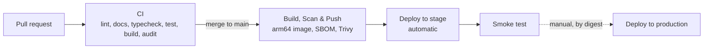

# Deploying and rolling back

The service ships as one container image, built once and promoted unchanged from stage to production. Infrastructure is OpenTofu in `infra/`; its inputs and resources are listed in [Infrastructure](../reference/infrastructure.md).

## Pipeline



| Workflow | Trigger | What it does |
| --- | --- | --- |
| `ci.yml` | Pull requests and pushes to `main` | Install, lint, documentation checks, typecheck, test, build; dependency audit |
| `build-push.yml` | CI success on `main`, a `v*` tag, or manual | Builds the `linux/arm64` image, generates an SPDX SBOM, fails on critical fixable vulnerabilities, pushes `sha-<commit>` and `latest` to ECR |
| `deploy.yml` | Build success on `main` (stage), or manual (stage or production) | Retags the image for the environment and forces a new ECS deployment, then waits for the service to stabilize |
| `smoke-test.yml` | Manual, or called by another workflow | Runs `scripts/smoke-test.sh` against a deployed endpoint |
| `infra-validate.yml` | Changes under `infra/` | `tofu fmt -check`, `tofu init -backend=false`, `tofu validate` |
| `docs.yml` | Documentation or source changes, and pushes to `main` | Builds this site, runs the public-content guard, and publishes to GitHub Pages from `main` |

AWS access uses GitHub OIDC; no long-lived credentials are stored in the repository.

## How an environment picks its image

Each ECS task definition references the image by environment tag (`stage` or `prod`). A deployment moves that tag to a specific digest, then forces a new deployment so tasks pull it. The ECS deployment circuit breaker is enabled with automatic rollback, so a deployment whose tasks never become healthy reverts to the previous task set.

Both the container health check and the load balancer target group check `GET /health/live`. `GET /health/ready`, which reports Solr schema validation, is not used for routing, so a task whose schema validation failed still receives traffic. Check `/health/ready` (the smoke test does) after every deployment.

## Deploy to production

Production is never automatic.

1. Confirm stage is healthy and the smoke test passed.
2. Get the image digest (`sha256:…`) running in stage from the build run's summary or from ECR.
3. Run the **Deploy** workflow manually with environment `production`, the digest, and the approver's name.

The workflow refuses a malformed digest or a missing approver, and warns if the digest is not the one currently tagged `stage`.

## Roll back

- **Unhealthy deployment:** the circuit breaker rolls back automatically.
- **Healthy but wrong:** run the **Deploy** workflow manually with the previous known-good digest. For stage, an empty digest deploys the `sha-<commit>` image of the branch you run it from.

Rolling back an image does not roll back infrastructure. Revert OpenTofu changes separately through `infra/`.

## Verify a deployment

```bash
./scripts/smoke-test.sh https://<service-host>
```

The script checks both health endpoints, sends an MCP `initialize`, confirms the five expected tools are listed, and runs a search that should return public JScholarship records. `SMOKE_TIMEOUT`, `REQUEST_TIMEOUT`, and `SMOKE_QUERY` adjust it.
